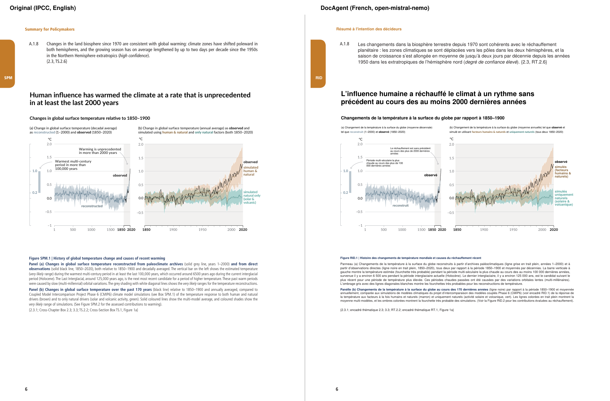
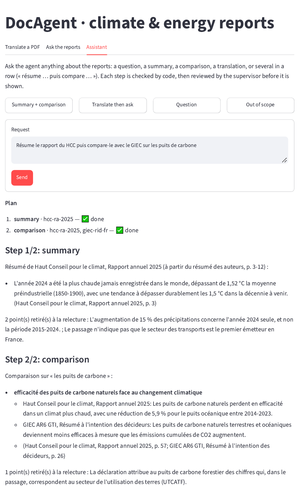
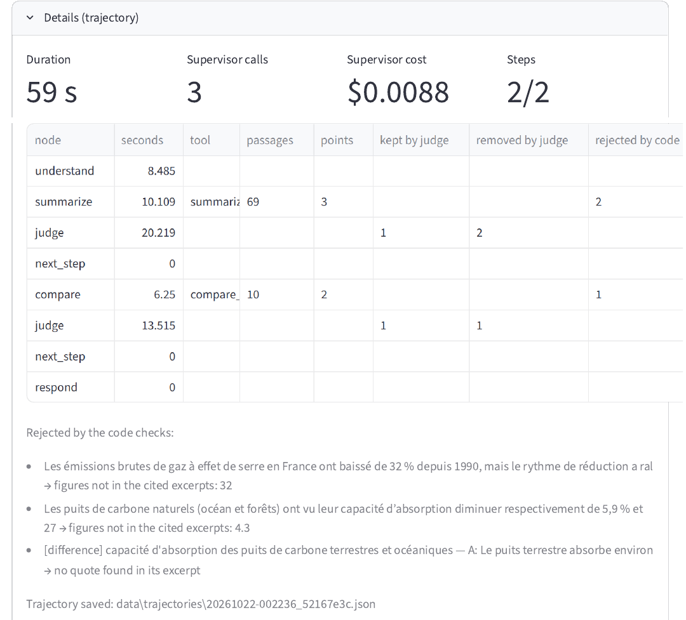
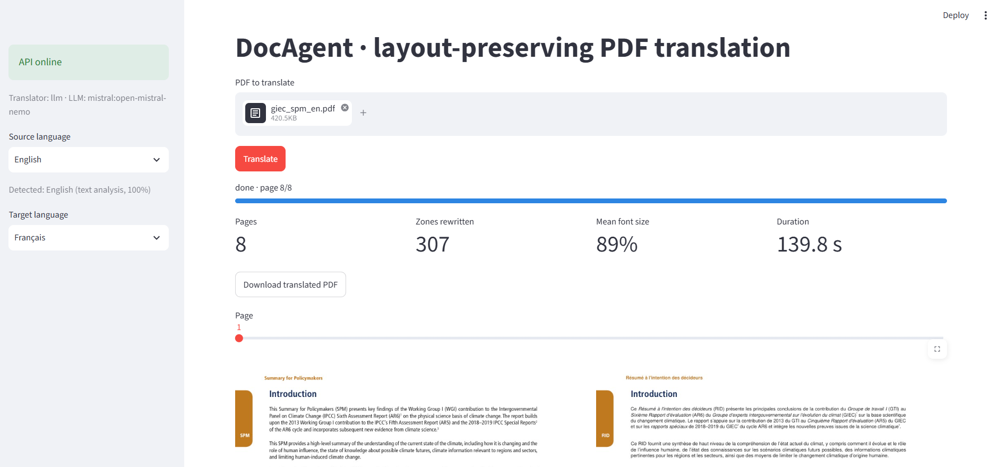
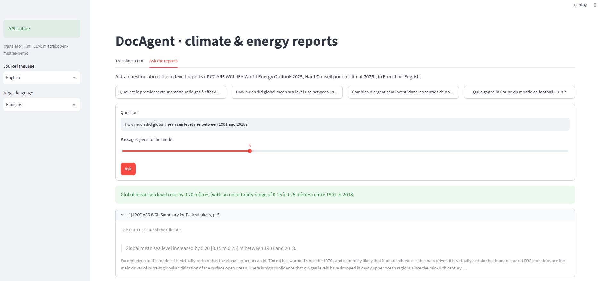

# DocAgent

[](https://github.com/lylyamm/docagent/actions/workflows/ci.yml)

Work with climate and energy reports (IPCC, IEA, French High Council on Climate) in three ways:

- **Translate** a PDF **without breaking its layout**: charts, colours, columns, footnotes and styles stay where they were. The PDF is split into text blocks, translated page by page by an LLM with validated JSON output, and each block is rewritten in place.
- **Ask the reports** a question in French or English and get an answer **with its sources**: report, page, and the sentence that proves it, checked by code before the answer is shown. When the reports do not say it, DocAgent says so instead of guessing.
- **Hand a request to an agent** (LangGraph): « résume le rapport du HCC puis compare-le avec le GIEC sur les puits de carbone ». A supervisor plans the steps, runs them with the tools above, and has every summary, comparison and answer reviewed before it is shown.



**Status:** v0.3, translator + question answering (RAG) + LangGraph agent. Agent evaluated (routing, review, whole runs); the ingestion agent is next (see [Roadmap](#roadmap)).

## What it does

**Translation**

- **Keeps the layout**: text is erased and rewritten in place; images, charts and backgrounds are untouched. Text grows into free space before its font is reduced, one-line headings stay on one line, paragraphs keep their spacing.
- **Keeps inline styles**: colour, bold, italic, superscript and subscript runs survive translation (footnote calls, CO₂, *likely*).
- **Uses the official terminology**: a glossary built from the official French IPCC summary (SPM → RID, *high confidence* → *degré de confiance élevé*); codes and acronyms (MED, CO2, SSP1-2.6) are never sent to the model.
- **Checks its own output**: after each translation, automatic checks that graphics survived, no source text is left, every number is still in place, no text overlaps, no zone is empty and no tag is printed as text.
- **Detects the source language** from the PDF metadata or its text.

**Questions on the reports (RAG)**

- **Hybrid search**: dense retrieval (multilingual embeddings, in Qdrant) for meaning and across languages, BM25 for exact words, codes and figures, fused with Reciprocal Rank Fusion. Every passage keeps its report and page.
- **Answers that can be checked**: the model answers only from the passages it is given and must copy, for each fact, the sentence that states it. The code verifies that the sentence is in the cited passage (words in order, figures exact) and that every figure of the answer appears in the cited passages. Otherwise, the answer is not shown.
- **Refuses when the reports do not answer**: off-topic and near-topic questions get "not found" rather than a plausible guess.
- **Measured**: retrieval and answers are evaluated on question sets with known answer pages, including a test set kept aside (see [Results](#results)).

**Agent (LangGraph)**

- **Understands a request and plans it**: one step (a question, a summary, a comparison, a translation) or up to 5 in order (« traduis … puis dis-moi … »). The plan comes from the supervisor's model as JSON; the code checks every step (reports exist, a summary has one report, a comparison 2 or 3) and turns what does not hold into a clarifying question.
- **Summaries and comparisons checked like answers**: a summary starts from the authors' own summary pages; a comparison has one side per report, and the code checks that each side quotes only its own report and never claims what a report does not contain.
- **A stronger model reviews the result**: after each step, the supervisor (Gemini 2.5 Pro on Vertex AI) reads every point next to its passages and removes the ones that do not say what the sources say. It can only remove, never add.
- **Asks before long work**: a translation of more than 50 pages pauses the agent (`interrupt()`) until the user says yes or no.
- **Every run is recorded**: a trajectory (plan, nodes, durations, points removed by the code and by the review, cost) is saved as JSON; the API and the front end show it while the agent works.
- **Cost guards**: at most 12 supervisor calls per request in the API, a 5-step limit enforced by code, and a monthly budget on the cloud project.



<details>
<summary>The same run's details: duration, supervisor calls and cost, each node, and the points rejected by the code checks</summary>



</details>

**All three**

- **Any OpenAI-compatible LLM**: Mistral, Groq, OpenRouter or a local Ollama model, chosen in `.env`.
- **A separate provider for the agent's supervisor and tools** (`AGENT_PROVIDER=vertex`, `TOOLS_PROVIDER=vertex`: Gemini on Vertex AI, pay-as-you-go, signed in with Google credentials, no key in `.env`).
- **API + web front end + Docker**: FastAPI (asynchronous translation jobs, `/v1/ask`, `/v1/agent`), a Streamlit front end with a side-by-side preview, an "Ask the reports" tab and an "Assistant" tab, Qdrant as a service; `docker compose up` runs the translation and question demo.

## Results

### Translation

IPCC AR6 WGI Summary for Policymakers, English → French, 8 pages, `open-mistral-nemo` (Mistral free tier):

| Measure | Value |
| --- | --- |
| Text zones rewritten | 307 |
| Mean font size | 90% of the original |
| Zones that did not fit | 0 |
| Automatic checks | all passed |
| LLM requests | 13 (1 retry) |
| Blocks handled without the model (codes, glossary) | 132 |
| Time | 2 to 4 min (rate-limited free tier) |

Translation quality (COMET, chrF against the official IPCC French version) will be measured in phase 6.

### Questions on the reports

Corpus: 5 public reports, about 1,000 pages, 4,970 passages (IPCC AR6 WGI SPM in English and French, IEA World Energy Outlook 2025 and its French summary, HCC annual report 2025). Answers by `open-mistral-nemo`, 5 passages per question.

**Test set kept aside** (15 questions with an answer, 4 without; written after all tuning, measured once):

| Measure | Value |
| --- | --- |
| Right page in the top 5: dense e5 / hybrid / BM25 | 93% / 87% / 73% |
| Answered, citing the right page | 12 / 15 |
| **Wrong answers shown** | **0** |
| Questions without an answer in the reports, refused | 4 / 4 |

The 3 questions not answered were refusals: two whose page the search missed (both cross-lingual, the weak spot of BM25) and one rejected by an over-strict check, since fixed.

**What the development set taught** (24 + 6 questions, used to build the system, scores optimistic):

| Choice | Measured |
| --- | --- |
| Embedding model | `multilingual-e5-base` (local) beats `mistral-embed` (API): 92% vs 67% of right pages in the top 5; paired sign test on the rank, p = 0.01 |
| Fusion | Hybrid helps only with a good dense model: with `mistral-embed` it lost pages BM25 had found |
| Checking the answers | Without checks, 2 wrong answers out of 24 (an invented ranking, a figure from the wrong passage); with verified quotes and figures, 0 |
| A prompt change | "Translate units" turned 15.6 Mt into "15.6 billion tonnes": reverted, units are now copied |

Every run is in [evals/rag_results.md](evals/rag_results.md) and every answer in [evals/answers/](evals/answers/).

### The agent

Supervisor `google/gemini-2.5-pro` on Vertex AI; tools on `open-mistral-nemo`, then `google/gemini-2.5-flash` (see *Whole runs*). Three evaluations, each one script ([evals/README.md](evals/README.md)):

**Routing**: is each request turned into the right plan? 25 requests in 8 kinds (question, summary, comparison, translation, several steps, ambiguous, unclear, out of scope), the router alone, each played twice.

| Measure | router-v3 (2 runs) | router-v4 |
| --- | --- | --- |
| Right plan | 49 / 50, 49 / 50 | **50 / 50** |
| Same plan on both runs | 21 / 25, 22 / 25 | **25 / 25** |
| Router call, median | 9.9 s, 7.6 s | 5.9 s |
| Cost per request | $0.002 | $0.002 |

v3's only error (s3, in 2 runs out of 4) and most of its changes came from a report in the corpus twice (the IEA WEO in English, its summary in French): v3 took one or the other, and once asked the user which. v4 takes the version in the request's language, since a summary's topic is searched in the report and the search is weaker across languages. That rule was written after reading v3's errors on these same 25 requests, so v4's score is optimistic.

**Review**: does the judge remove what is wrong and keep what is right? Real passages of the reports, each with a faithful statement and a trap that keeps every figure but changes the meaning (two periods swapped, the ocean and land sinks swapped, a carbon budget "respected" instead of exceeded, a record called a fall): the checks in code let a trap through, only the review can catch it. Each statement judged alone, 3 times.

| Measure | judge-v2 | judge-v3 |
| --- | --- | --- |
| Traps removed | **15 / 15** | **15 / 15** |
| Faithful statements removed | **0 / 15** | **0 / 15** |
| Same verdict on the 3 runs | 10 / 11 statements | 11 / 11 |
| A nuance left out ("−27 %" without "compared with no climate change") | removed 2 times out of 3 | 3 times out of 3 |

The review's reason for removing the borderline statement holds: without the comparison, a relative drop reads as an observed loss. judge-v3 came from a whole run: v2 removed a right point as "attributed to a 2025 IEA report that does not exist", the WEO 2025 being newer than the judge's training data; v3 judges against the passages only. Its first run removed one faithful statement once, for a real ambiguity of that statement ("compared with no climate change" placed where it read as applying to both sinks, while the report says it of the land sink only); the statement was rewritten, then measured again (above).

**Whole runs**: 4 requests (a question, a summary, a comparison, then both in one request) through router, tools and review ([scripts/agent_eval_runs.py](scripts/agent_eval_runs.py)), twice with each tools' model. Same router, same review: only `TOOLS_MODEL` changes.

| Tools' model | Points and answers kept by the review | Duration per request | Cost per request (supervisor + tools) |
| --- | --- | --- | --- |
| `open-mistral-nemo` (free tier) | 9 / 24 (38 %) | 41 to 98 s (two outliers, 139 and 491 s: a cold machine loading the index, and "resource exhausted" retries) | about $0.006 (tools free) |
| `google/gemini-2.5-flash` | **28 / 32 (88 %)** | 44 to 113 s | about $0.015 |

The last run, with Gemini 2.5 Flash and judge-v3 (22 October 2026):

| Request | Steps | Duration | Cost (supervisor + tools) | Points kept by the review |
| --- | --- | --- | --- | --- |
| Que dit le HCC sur les émissions des transports en 2024 ? | question | 68 s | $0.007 | 1 / 1 |
| Résume le rapport annuel 2025 du HCC | summary | 56 s | $0.017 | 4 / 5 |
| Compare l'AIE et le GIEC sur les trajectoires compatibles avec 1,5 °C | comparison | 44 s | $0.008 | 2 / 2 |
| Résume le rapport du HCC puis compare-le avec le GIEC sur les puits de carbone | summary, comparison | 113 s | $0.028 | 4 / 5, 3 / 3 |

- **The tools' model was the weak link**: with `open-mistral-nemo`, the review removed most of what the tools wrote, each time with a named error; those checked against the passages were real (a date of one report given to the other, "among the 10 wettest years" turned into "record rainfall", causes of road transport given to the whole sector). The same question was answered, refused and removed in three runs. With Gemini 2.5 Flash the tools write more points and the review keeps 88 % of them; what it still removes is real (a condition the report states for the land sink applied to the ocean sink).
- **Half of the time is the supervisor's**: 48 to 58 % of each request in the last run is Gemini 2.5 Pro reasoning (plan and review). In a question, the search takes 0.2 s and the tools' model 3 to 9 s; the rest of the tool time is loading the index in a new process.

Every run is in [evals/agent_results.md](evals/agent_results.md), every plan and verdict in [evals/agent_runs/](evals/agent_runs/).

## Quickstart with Docker

```bash
git clone https://github.com/lylyamm/docagent.git
cd docagent

# Layout demo, no API key needed (the "translation" is the text in upper case, 20% longer):
TRANSLATOR=fake docker compose up --build

# Real translation: choose a provider and put its key in .env
cp .env.example .env
docker compose up --build
```

Front end: http://localhost:8501 · API docs: http://localhost:8000/docs · Qdrant dashboard: http://localhost:6333/dashboard

Three services: `api` (FastAPI, with the `multilingual-e5-base` model baked into the image, CPU only), `front` (Streamlit) and `qdrant` (vector database).

**Questions on the reports** need the search index. Download the 5 reports listed in [data/corpus.json](data/corpus.json) into `data/raw/`, then build it once inside Docker (about 45 min on a laptop CPU, nothing leaves the machine):

```bash
docker compose --profile index run --rm indexer   # passages in data/index/, vectors in qdrant
docker compose up                                 # then the "Ask the reports" tab
```

Already built an index locally (see below)? Copy its vectors instead, in a few seconds:

```bash
docker compose up -d qdrant
uv run python scripts/rag_copy_vectors.py
docker compose up
```





On Windows PowerShell, the first command is `$env:TRANSLATOR="fake"; docker compose up --build`.

## Local development

Requires [uv](https://docs.astral.sh/uv/).

```bash
uv sync --extra local --extra vertex --group front            # everything (plain `uv sync`: core + dev only)
uv run pytest                                                  # 276 tests, no network, no key
uv run pytest -m "not slow"                                    # the same without the PDF rebuilds: ~15 s
uv run pytest --cov=docagent                                   # with coverage (96 %)
uv run pre-commit install --hook-type pre-commit --hook-type pre-push   # ruff and checks before each commit, fast tests before each push

uv run python scripts/rebuild.py                               # fake translation of every sample + checks
uv run python scripts/translate.py data/samples/giec_spm_en.pdf --pages 1 2   # real LLM translation

uv run uvicorn docagent.api.app:serve --factory --reload       # API on http://localhost:8000/docs
uv run --group front streamlit run front/app.py                # front end on http://localhost:8501
```

Outputs (translated PDFs, side-by-side comparisons, debug PDFs) go to `data/output/`.

### Questions on the reports

1. Download the 5 reports listed in [data/corpus.json](data/corpus.json) (public links) into `data/raw/`.
2. Build the index, once (about 45 min on a laptop CPU with the local model; nothing leaves the machine):

```bash
uv sync --extra local                                          # sentence-transformers for the local model
uv run python scripts/rag_index.py --embedder e5               # passages + vectors in data/index/
```

3. Put `EMBEDDER=e5` in `.env`, then:

```bash
uv run python scripts/rag_ask.py "Quel est le premier secteur émetteur de gaz à effet de serre en France en 2024 ?"
uv run python scripts/rag_search.py "carbon budget 1.5°C" --mode hybrid   # search only, no LLM

uv run python scripts/rag_eval.py --embedder e5 mistral        # retrieval: hit@k, MRR, paired tests
uv run python scripts/rag_eval_answers.py                      # answers: cited the right page, refusals
```

Locally the vector store runs embedded (a folder, no server): one program at a time can open it, so stop the API before running the scripts. In Docker it is the `qdrant` service, which has no such limit.

### The agent

The agent uses the search index above (tools on `LLM_MODEL`) and a supervisor model. With Gemini on Vertex AI:

1. A Google Cloud project with billing and the Vertex AI API enabled (`gcloud services enable aiplatform.googleapis.com`), and a budget alert.
2. Sign in once on the machine, no key stored:

```bash
gcloud auth application-default login
gcloud auth application-default set-quota-project <project id>
```

3. In `.env`: `AGENT_PROVIDER=vertex`, `VERTEX_PROJECT=<project id>`, `AGENT_MODEL=google/gemini-2.5-pro` (and, for the cost estimate, `AGENT_PRICE_IN_USD` / `AGENT_PRICE_OUT_USD`). Without them, the supervisor uses the tools' provider (`AGENT_MODEL` alone picks another model there).
4. Optional, the tools' model on Vertex AI too (answers, summaries, comparisons; the translator keeps `LLM_*`): `TOOLS_PROVIDER=vertex`, `TOOLS_MODEL=google/gemini-2.5-flash`, and `TOOLS_PRICE_IN_USD` / `TOOLS_PRICE_OUT_USD` for the cost in `scripts/agent_eval_runs.py`.

```bash
uv sync --extra local --extra vertex
uv run python scripts/agent_chat.py --show-plan                # talk to the agent in the terminal
uv run python scripts/agent_chat.py --fake-translator          # same, translations without LLM
```

Or start the API and the front end (above) and open the **Assistant** tab. Each request is saved as a trajectory in `data/trajectories/`.

## API

| Method | Path | |
|---|---|---|
| `POST` | `/v1/detect` | multipart `file` (PDF) → its language, from the PDF metadata or its text |
| `POST` | `/v1/translate` | multipart `file` (PDF), `source_lang` (`auto` by default), `target_lang` → `202 {job_id}` |
| `GET` | `/v1/jobs/{job_id}` | status (`queued`, `running`, `done`, `failed`), page progress, summary |
| `GET` | `/v1/jobs/{job_id}/download` | translated PDF |
| `POST` | `/v1/ask` | JSON `{"question": ..., "top_k": 5}` → answer, sources (report, page, verified quotes), timings |
| `POST` | `/v1/agent` | JSON `{"request": ...}` → `202` run: the agent works in the background |
| `GET` | `/v1/agent/{run_id}` | status (`queued`, `running`, `needs_confirmation`, `done`, `failed`), plan, nodes done, parts of the message already written, then the message and the run's details |
| `POST` | `/v1/agent/{run_id}/resume` | JSON `{"answer": "oui"}` → answer the agent's question (a long translation) and continue |
| `GET` | `/health` | liveness and configured LLM |

## How it works

**Translation**

1. **Extract** (`src/docagent/pdf/extract.py`): PyMuPDF gives blocks → lines → spans → characters. Blocks are the translation unit; runs whose style differs from the block's become tags (`<s1>…</s1>`). Bullets and footnote numbers are cut out and kept in place; numbers, formulas and vertical text are not translated.
2. **Translate** (`src/docagent/translate/`): one request per page, JSON in and out, validated with Pydantic; retries with exponential backoff; blocks the model skipped are asked again alone; broken style tags are repaired locally when possible; results are cached on disk.
3. **Rebuild** (`src/docagent/pdf/rebuild.py`): redactions erase the text only; `insert_htmlbox` rewrites it in the original font when it has the glyphs, in a box grown into free space, shrinking the font only as needed (same scale for blocks of the same style).
4. **Verify** (`src/docagent/pdf/verify.py`): automatic checks on the output (see *What it does*).

**Questions** (`src/docagent/rag/`)

```
question ──► embed (e5) ──► Qdrant: 20 nearest passages ──┐
         └─► BM25: 20 best passages ──────────────────────┴─► RRF ─► 5 passages, numbered [1]..[5]
                                                                         │
             LLM: answer only from these, cite [n], copy the sentence ◄──┘
                                                                         │
             code: quote really in passage n? figures in the cited passages? ──► answer or "not found"
```

5. **Passages** (`chunking.py`): built from the extracted blocks, so every passage has a page; about 1,000 characters with overlap, cut at headings, prefixed with the report title and section; running headers, tables of contents and footnote placement handled.
6. **Search** (`bm25.py`, `embeddings.py`, `store.py`, `fusion.py`, `search.py`): BM25 written by hand to keep codes and figures whole ("SSP1-2.6", "1,5"); embeddings from a local model or an API, one Qdrant collection per model; Reciprocal Rank Fusion of the two rankings.
7. **Answer** (`answer.py`): numbered passages, JSON answer with evidence, verification in code, and the reasons of each refusal kept for evaluation.
8. **Evaluate** (`evaluation.py`, `scripts/rag_eval*.py`): hit@k and MRR for the search, paired tests (McNemar, sign test) to compare two systems on the same questions, answer-level metrics, and a test set kept aside ([evals/README.md](evals/README.md)).

**Agent** (`src/docagent/agent/`)

```
                   ┌──────────────┐
  request ───────► │  understand  │  supervisor model: the plan (1 to 5 steps), checked by code
                   └──────┬───────┘
                          ▼
          ┌──────────── for each step ─────────────┐
          │                                        │
          │  question / summarize / compare        │  translate (sub-graph:
          │      tool (search + LLM)               │  inspect → confirm? → translate)
          │      + checks in code                  │      │  pauses for a yes/no
          │            │                           │      │  beyond 50 pages
          │            ▼                           │      │
          │  judge: supervisor model, removes      │      │
          │  points their sources do not support   │      │
          │            │                           │      │
          │            ▼                           │      ▼
          │        next_step ◄─────────────────────┼──────┘
          └────────────┬───────────────────────────┘   a step that fails stops the chain
                       ▼
                    respond: one part per step, written by code
```

9. **Tools** (`tools.py`, `grounded.py`): the translator and the search above, plus a summary (from the report's own summary pages, or the passages most relevant to a focus) and a comparison (each report searched on its own, one side per report, attribution and absence claims checked in code). Points that fail a check are dropped one by one, with the reason kept.
10. **Graph** (`supervisor.py`, `graph_translation.py`, `checkpoint.py`): a typed state, branches chosen by code from the state, the translation as a sub-graph whose `interrupt()` pauses the whole agent, an in-memory checkpointer keyed by `thread_id` so a paused run resumes where it stopped.
11. **Review** (`judge.py`): each point is read next to its quotes and whole passages; only a nameable error removes it (a figure attached to something else, a fact in no passage, a contradiction, the wrong report), not an omission or a paraphrase. If the review fails, the points are kept and marked "not reviewed".
12. **Runs and trajectories** (`runs.py`, `trajectory.py`): the graph is streamed node by node; each node's duration, tool, passages read, points rejected by code and removed by review are recorded, and for a question the reason of a refusal and where its time went (search, model, loading); the API runs requests one at a time in a worker thread, each with its own supervisor call budget.
13. **Evaluate** (`evaluation.py`, `scripts/agent_eval_*.py`): the router alone on 25 requests with the plans each accepts; the review alone on faithful statements and traps built from real passages; whole runs for time and cost.

## Limitations

- Vertical text (rotated axis labels) is not translated yet.
- Embedded fonts are subsets without accented letters, so French text often falls back to a generic, wider font: the main reason text is shrunk.
- LaTeX formulas and drop caps in scientific papers still cause a few overlaps.
- Scanned PDFs (images without text) need OCR, not supported.
- A small free model makes occasional translation mistakes; larger models will be compared in phase 6.
- Agent: 45 to 115 seconds per request, about half of it the supervisor's reasoning; Gemini on Vertex AI is a shared model and sometimes answers "resource exhausted" (retried with growing pauses). With a small free tools' model (`open-mistral-nemo`) the review removes most points, so a request can end with little kept: the agent needs a stronger one (`TOOLS_MODEL=google/gemini-2.5-flash`, about 1.5 cent per request). The evaluation sets are small (25 requests, 11 statements, 2 runs of 4 requests per tools' model), and the routing and review sets have been used to tune the router and the review. Runs are kept in memory (one API process, one request at a time); the agent is not in the Docker image yet (it needs Google credentials).
- Questions: the evaluation sets are small (24 and 15 questions), so differences of one or two questions are not significant. Cross-lingual search relies on the dense model alone, since BM25 needs shared words. The answer checks catch invented quotes and figures, not a true sentence taken from the wrong passage. Indexing with a local model takes about 45 min on a laptop CPU.

## Roadmap

1. ~~**PDF core**: extraction and in-place reconstruction with a fake translation~~
2. ~~**Translator v1**: LLM translation, FastAPI, Docker, web front end~~
3. ~~**RAG**: hybrid search with page-level citations, verified answers, evaluation, Qdrant as a Docker service~~
4. **Agent**: ~~LangGraph supervisor planning translate / ask / summarize / compare steps, reviewed results, API and front end, evaluation of the routing, the review and whole runs~~; ingestion agent with MCP tools (fetch) to keep the corpus up to date
5. **Industrialization**: CI/CD, cloud deployment, tracing and cost monitoring
6. **Evaluation**: translation benchmark (COMET, chrF) against official IPCC French versions

## Project layout

```
src/docagent/pdf/        # extraction, reconstruction, checks, language detection
src/docagent/translate/  # translators (fake, OpenAI-compatible LLM), cache, glossary, tag repair
src/docagent/rag/        # passages, BM25, embeddings, Qdrant, fusion, search, answers, metrics
src/docagent/agent/      # LangGraph agent: tools, supervisor, review, translation sub-graph, runs, trajectories
src/docagent/chat.py     # small client for JSON answers from the LLM (fixed key or refreshed token)
src/docagent/gcp.py      # Google sign-in for Vertex AI (application default credentials)
src/docagent/api/        # FastAPI app: translation jobs, questions, agent runs
front/app.py             # Streamlit front end (translate, ask, assistant)
scripts/                 # translation, indexing, search, question, agent, evaluation and vector copy scripts
tests/                   # pytest suite (no network)
evals/                   # question sets, agent requests and traps, results, saved answers and plans
data/samples/            # public PDF excerpts (see data/SOURCES.md)
data/corpus.json         # the reports indexed for questions, with their public links
data/glossary_en_fr.json # imposed terminology (official IPCC French)
```

## Data and license

All documents are public reports; sample excerpts and their sources are listed in [data/SOURCES.md](data/SOURCES.md), the indexed reports in [data/corpus.json](data/corpus.json). Full reports and the search index are not versioned. The code is under the MIT license.
